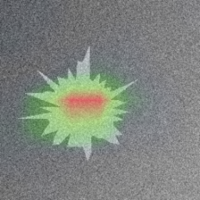

# Medical Image Cancer Detection Prototype

A CNN prototype that classifies a medical image as **benign** or **malignant**, built to
demonstrate an end-to-end deep learning pipeline: image standardization, transfer learning,
calibrated probability output, an adjustable decision threshold, visual interpretability, and a
reviewer-facing interface.

`Python` · `PyTorch` · `EfficientNet-B0` · `Grad-CAM` · `Streamlit`

[](https://github.com/Justin-Fekri/medical-image-cancer-detection-prototype/actions/workflows/ci.yml)


---

## ⚠️ Not a diagnostic tool

**This is an educational and research project. It is not a medical device, it has not been
clinically validated, and it has not been cleared by any regulator.** Its output is not a
diagnosis, a screening result, or a medical opinion, and it must not be used to inform a
decision about any real person's care. The repository ships with **synthetic images**, so any
metric you reproduce here describes the software pipeline and nothing about clinical accuracy.
Do not upload identifiable patient data to the app.

This warning is repeated on screen in the Streamlit interface and in the CLI output, by design.

---

## What it does

| Claim | Where it lives |
|---|---|
| Standardizes every image to 224 x 224 RGB | One shared transform in [`src/data.py`](src/data.py), used identically at training, evaluation and inference time |
| Produces a sigmoid probability | Single-logit head in [`src/model.py`](src/model.py); `BCEWithLogitsLoss` for training, `sigmoid` for reporting |
| Applies an adjustable classification threshold | Never hardcoded — a CLI flag, a Streamlit slider, and a value chosen on validation data and stored in the checkpoint |
| Visual interpretability | Grad-CAM implemented over torch hooks in [`src/interpretability.py`](src/interpretability.py) |
| Reviewer oversight | [`app/streamlit_app.py`](app/streamlit_app.py) shows the probability, the threshold, the margin between them, and the saliency overlay |

## Quickstart

```bash
git clone <your-repo-url>
cd medical-image-cancer-detection
python3 -m venv .venv && source .venv/bin/activate
pip install -r requirements.txt
```

```bash
# 1. Generate the synthetic sample dataset (no download required)
python scripts/make_sample_data.py --n 150

# 2a. Train -- laptop CPU, no GPU. Head-only, finishes in minutes.
python -m src.train --freeze-backbone --epochs 3 --batch-size 32

# 2b. Train -- GPU available. Full two-phase fine-tuning.
python -m src.train --epochs 15 --batch-size 32

# 3. Evaluate on the held-out test split
python -m src.evaluate

# 4. Classify a single image, saving the Grad-CAM overlay
python -m src.predict data/test/malignant/malignant_00000.png \
    --threshold 0.5 --save-overlay assets/overlay_demo.png

# 5. Launch the reviewer interface
streamlit run app/streamlit_app.py
```

## Results on the bundled synthetic data

A reference run — `--freeze-backbone --epochs 3 --batch-size 32`, 150 images per class,
on a 2019 dual-core i5 MacBook Pro with **no GPU**:

| | |
|---|---|
| Validation AUROC | 0.9793 |
| Test AUROC | 0.9483 |
| Test accuracy @ threshold 0.51 | 0.9091 (sens 0.9091, spec 0.9091) |
| Wall clock | ~10 minutes, 3 epochs |

**These numbers describe geometric shapes, not tissue.** The generator draws smooth blobs for one
class and spiculated blobs for the other; separating them is meant to be easy. The run proves the
pipeline trains, converges, thresholds and explains itself — nothing more. Treat it as a smoke
test, and re-measure on real data before quoting any figure.

The threshold sweep from that run also shows the model is **uncalibrated**: every meaningful
operating point sits between 0.45 and 0.60, and outside that band the classifier collapses to
all-positive or all-negative. That is expected after three epochs of linear probing, and it is
exactly why the app reports the raw probability and its distance from the threshold instead of a
bare verdict.



*Grad-CAM on a held-out malignant sample: the heatmap concentrates on the spiculated lesion rather
than the background.*

## Runtime, and why there is a `--freeze-backbone` flag

Backpropagating through all of EfficientNet-B0 on a CPU costs roughly **4x** a head-only step —
measured on the machine above at ~35 s versus ~8.5 s per batch of 16. That is the difference
between a coffee break and an afternoon:

| Mode | Trains | Cost per epoch (212 images, CPU) |
|---|---|---|
| `--freeze-backbone` | Classifier head only | ~3 min |
| default (two-phase) | Head, then the whole network | ~20 min |

Use `--freeze-backbone` on a laptop and the default on a GPU. Both write the same checkpoint
format, and the checkpoint records which mode produced it.

The checkpoint is rewritten **every time validation AUROC improves**, not only at the end, so an
interrupted run still leaves something usable on disk.

## The threshold is the point

A sigmoid gives a probability; turning that probability into a label requires choosing an
operating point, and that choice is a trade-off, not a detail:

- **Lower threshold** → higher sensitivity, more false alarms. Appropriate when a missed positive
  is the expensive error.
- **Higher threshold** → higher specificity, more missed positives.

So the project refuses to bury it. `src/train.py` picks a threshold on validation data via
`best_threshold_for_sensitivity` (the most specific threshold that still reaches 90% sensitivity)
and writes it into the checkpoint. `src/evaluate.py` prints a full sweep instead of one accuracy
number. The Streamlit app puts a slider in front of the reviewer and relabels live — the model
runs once, and only the comparison changes.

## Project layout

```
├── app/
│   └── streamlit_app.py      # Reviewer UI: upload, probability, threshold slider, Grad-CAM
├── scripts/
│   └── make_sample_data.py   # Synthetic dataset generator
├── src/
│   ├── config.py             # Image size, normalization stats, TrainConfig
│   ├── data.py               # Transforms, ImageFolder loaders, class-balanced sampling
│   ├── model.py              # EfficientNet-B0 + single-logit head, checkpoint I/O
│   ├── interpretability.py   # Grad-CAM via forward/backward hooks, heatmap overlay
│   ├── metrics.py            # AUROC, confusion matrix, threshold sweep
│   ├── train.py              # Two-phase fine-tuning, early stopping
│   ├── evaluate.py           # Test-split scoring + threshold sweep
│   └── predict.py            # Single-image CLI
└── tests/                    # pytest suite, CPU-only, no checkpoint needed
```

## How it is trained

- **Transfer learning.** EfficientNet-B0 pretrained on ImageNet, with the classifier replaced by
  `Dropout → Linear(1)`.
- **Two-phase schedule.** The backbone is frozen for the first few epochs so the randomly
  initialized head can settle without large gradients washing out the pretrained filters, then
  everything unfreezes at one tenth the learning rate.
- **Class imbalance.** A `WeightedRandomSampler` oversamples the minority class, since a model can
  otherwise score well by never predicting malignant.
- **Conservative augmentation.** Flips, small rotations, mild jitter — plausible variations in how
  a scan is captured. No aggressive crops, which could remove the structure being classified.
- **Model selection on AUROC**, not accuracy, because AUROC is threshold-independent and accuracy
  on a skewed dataset is misleading. Early stopping on the same metric.

## Using a real dataset

Delete the synthetic images and arrange your own in the same `ImageFolder` layout:

```
data/
├── train/{benign,malignant}/*.png
├── val/{benign,malignant}/*.png
└── test/{benign,malignant}/*.png
```

Class directories are read alphabetically, so `benign` is index 0 and `malignant` is index 1 —
matching `CLASS_NAMES` in `src/config.py`. Nothing else needs to change; point `--data-dir` at
your directory and train. Suitable public starting points include the BreakHis histopathology
archive, the PatchCamelyon benchmark, and the Breast Ultrasound Images (BUSI) dataset. Check each
dataset's licence and terms before use.

If you train on real data, re-read the limitations below before reporting any number from it.

## Limitations

Stated plainly, because a prototype that hides these is worse than no prototype:

1. **The bundled data is synthetic.** The generator draws smooth blobs for one class and
   spiculated blobs for the other. Separating them is easy and says nothing about real tissue.
2. **No calibration.** The sigmoid output is a score, not a calibrated probability of disease.
   A 0.8 does not mean 80% of such cases are malignant.
3. **Single 2D image, single model.** No volumetric context, no patient history, no ensembling,
   no test-time augmentation, no uncertainty estimate.
4. **Grad-CAM explains where, not why.** A plausible-looking heatmap does not prove the model used
   clinically meaningful features; models routinely latch onto scanner artifacts and annotation
   marks. Treat the overlay as a debugging aid.
5. **No subgroup evaluation.** Performance is not broken down by scanner, site, or demographic
   group, which is exactly where medical imaging models tend to fail unevenly.
6. **No external validation.** Train, validation and test splits come from one generator with one
   distribution.

## Running the tests

```bash
pytest
```

22 tests covering the standardization contract (grayscale, RGBA and non-square inputs all become
`1 x 3 x 224 x 224`), model output shape and probability bounds, freeze/unfreeze behaviour, metric
correctness against hand-computed confusion matrices, and Grad-CAM output range and hook cleanup.
They run on CPU in about 15 seconds and need no trained checkpoint.

## Troubleshooting

**`URLError: CERTIFICATE_VERIFY_FAILED` when downloading pretrained weights** — a python.org
install on macOS ships without a CA bundle. Either run
`/Applications/Python\ 3.12/Install\ Certificates.command`, or:

```bash
export SSL_CERT_FILE=$(python -c "import certifi; print(certifi.where())")
```

**`RuntimeError: Numpy is not available`** — a NumPy 2.x install against a torch build compiled
for the NumPy 1.x C API. `requirements.txt` caps NumPy below 2.0 for this reason; run
`pip install -r requirements.txt` again.

## Licence

MIT — see [LICENSE](LICENSE).
