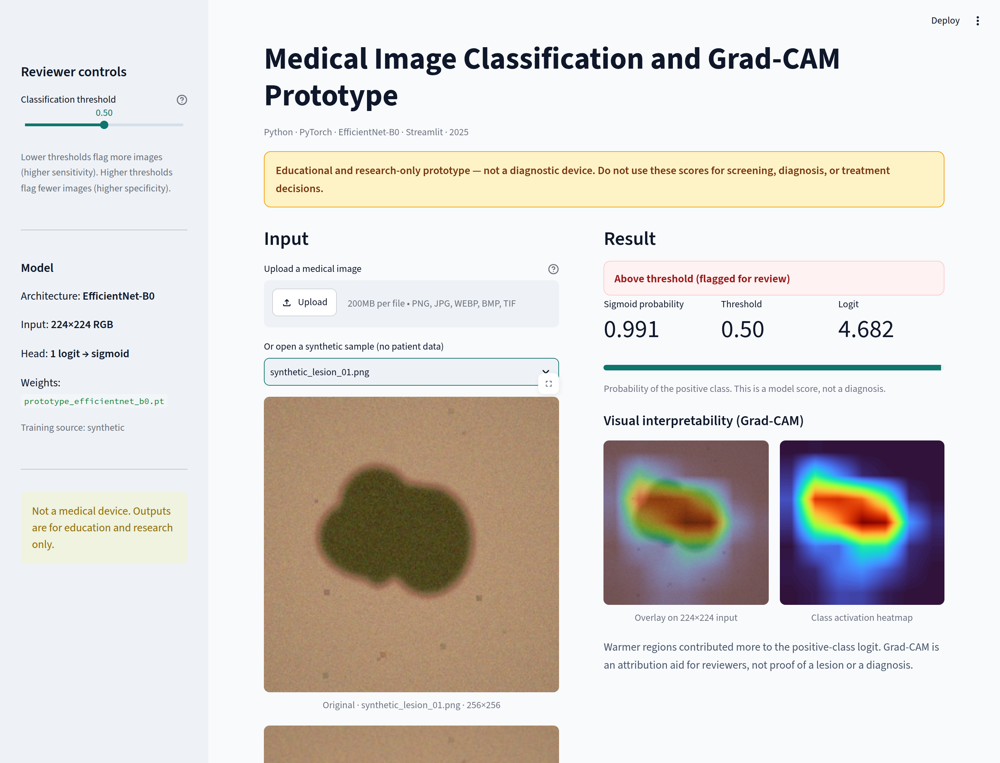
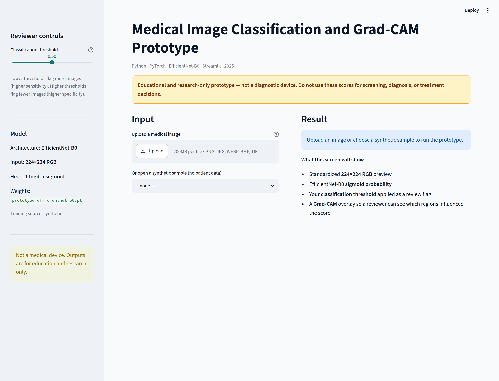

# Medical Image Classification and Grad-CAM Prototype


Educational and research-only CNN prototype (2025). **This is not a diagnostic device** and must not be used to screen, diagnose, treat, or rule out cancer.

The app takes a medical image, standardizes it to **224×224 RGB**, scores it with **EfficientNet-B0** (PyTorch), and shows a **sigmoid probability** against an **adjustable classification threshold**. **Grad-CAM** overlays highlight regions that influenced the score so a reviewer can inspect the decision.

Read [DISCLAIMER.md](DISCLAIMER.md) before running anything.



The screenshot above is the bundled synthetic checkpoint scoring `samples/synthetic_lesion_01.png`. Grad-CAM localizes to the generated lesion, which confirms the attribution path is wired correctly — it is **not** evidence that the network learned clinically meaningful features. The samples are generated, and the two classes were drawn to be easy to separate.


## What you get

- Streamlit workbench for upload + synthetic samples
- EfficientNet-B0 binary head (`1` logit → sigmoid)
- Adjustable review threshold (default `0.50`)
- Grad-CAM heatmap and overlay
- Training script for your own `negative/` / `positive/` folders
- A bundled checkpoint trained **only on synthetic images** so the UI works out of the box
- A deterministic stratified train/validation split with ROC-AUC, F1, sensitivity, and specificity

The bundled weights are **not** a clinical model. They exist so GitHub clones can run the interface immediately.

## Quick start

```bash
python3 -m venv .venv
source .venv/bin/activate
pip install -r requirements.txt
streamlit run app.py --server.port 43127 --server.address 0.0.0.0
```

Open `http://127.0.0.1:43127`. Upload a PNG/JPEG (or pick a file under `samples/`). Move the **Classification threshold** slider to see how the review flag changes without re-running the network.




CPU is enough. A GPU is optional (`python train.py --device cuda`).

## Train on your own images

```
data/
  negative/   # or benign/
  positive/   # or malignant/
```

```bash
python train.py --data-dir data --epochs 10 --output checkpoints/prototype_efficientnet_b0.pt
```

Regenerate the synthetic demo checkpoint:

```bash
python train.py --synthetic --epochs 8 --n-synthetic 24 --output checkpoints/prototype_efficientnet_b0.pt
```

By default the EfficientNet-B0 backbone is initialized from ImageNet and frozen; only the binary head is trained. Pass `--unfreeze-backbone` to fine-tune the convolutional features.

The training command reserves 20% of each class for image-level validation. Checkpoint metadata records the split seed and the final validation metrics. For real medical datasets, replace this with a patient-level split so images from the same person cannot appear in both training and validation.

Example reproducible synthetic validation run (`seed=2025`, `epochs=8`, `n_synthetic=24` per class):

| Setting | Result |
| --- | ---: |
| Training images | 38 |
| Validation images | 10 |
| Validation ROC-AUC | 1.000 |
| Validation F1 | 1.000 |
| Validation sensitivity | 1.000 |
| Validation specificity | 1.000 |

The generated positive and negative images are intentionally easy to separate. These scores confirm that training, checkpointing, inference, and evaluation work together. They are not medical-performance claims.

The complete run metadata is committed in `evaluation/synthetic_results.json`. The bundled checkpoint remains a UI demonstration artifact and should be replaced for any real experiment.

## Tests

```bash
python -m pytest -q
```

## Project layout

```
app.py                 Streamlit interface
train.py               Binary training entry point
meddetect/             Model, preprocess, Grad-CAM, inference
samples/               Synthetic PNGs (no patient data)
checkpoints/           Prototype EfficientNet-B0 weights
tests/                 Preprocess, threshold, Grad-CAM checks
```

## Design notes

| Piece | Choice |
| --- | --- |
| Architecture | EfficientNet-B0 (torchvision) |
| Input | 224×224 RGB, ImageNet mean/std |
| Output | Single logit + sigmoid probability |
| Decision | `probability >= threshold` |
| Interpretability | Grad-CAM on the last feature block |

## Limitations

- The bundled checkpoint is trained and validated only on generated images with deliberately different visual patterns.
- Synthetic validation scores show that the code path works. They do not estimate performance on clinical images.
- The repository does not include an external test set, patient-level split, demographic subgroup analysis, or clinical review.
- Grad-CAM indicates which pixels influenced the network. It does not prove that the model learned medically relevant features.
- A real experiment must state the dataset license, inclusion criteria, class balance, preprocessing, patient-level split, and confidence intervals.

## License

MIT. The license does not grant permission to use this software as a medical device.
